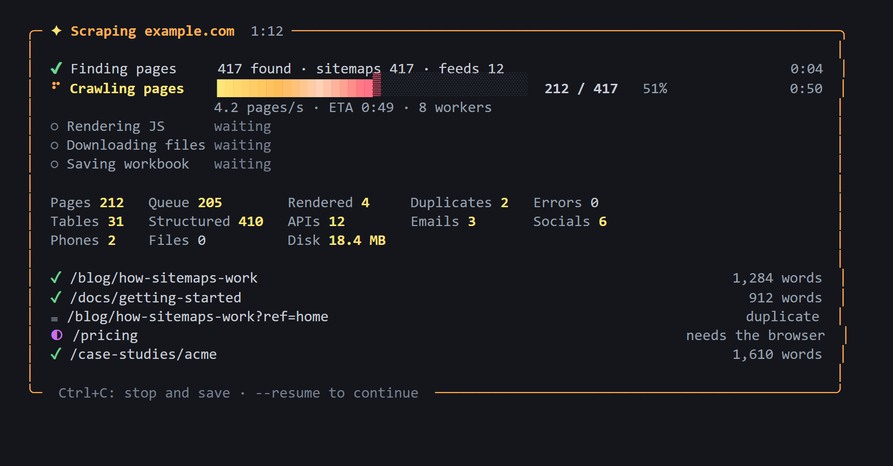

<p align="center">
  
</p>

<p align="center">
  <a href="https://github.com/AmonHooriLal/Site-Scraper-Main/actions/workflows/ci.yml"></a>
  
  <a href="LICENSE"></a>
  
</p>

<p align="center">
  <b>Paste a website URL. Get its public content back as clean, organised files.</b><br>
  Pages, articles and case studies as JSON and Markdown, every table as CSV, documents, images, contacts and
  structured data, all collected in one Excel workbook, with a live dashboard while it runs.
</p>

<p align="center">
  <a href="https://amonhoorilal.github.io/Site-Scraper-Main/">Website</a> ·
  <a href="#quick-start">Quick start</a> ·
  <a href="#what-you-get-site-data-yyyy-mm-dd">Output</a> ·
  <a href="#responsible-use">Responsible use</a>
</p>

<p align="center">
  
</p>

## Features

| | |
|---|---|
| 🔎 **Finds every page**: sitemaps, feeds, links, pagination and language versions | ⚡ **Fast and polite**: parallel downloads, a rate limit per site, robots.txt honoured |
| 🧠 **Handles JavaScript sites**: renders them in Edge or Chrome and records the JSON they load | 🧹 **Clean text**: main content only, with menus, footers and duplicate pages removed |
| 📊 **Tables and structured data**: CSV tables, products, articles, FAQs, events, contacts | 🏗️ **Built for big sites**: SQLite state, resume, time, size and file limits, crawler-trap protection |

## Quick start

```bash
git clone https://github.com/AmonHooriLal/Site-Scraper-Main.git
cd Site-Scraper-Main
pip install -e ".[full]"
site-scraper https://example.com
```

> **Status: beta (v0.1.0).** It works well on the sites it has been tested on (corporate, e-commerce, documentation, blogs, Wikipedia, government sites), but expect rough edges. Issues and pull requests are welcome.

## Install

Requires Python 3.10 or newer.

```bash
git clone https://github.com/AmonHooriLal/Site-Scraper-Main.git
cd Site-Scraper-Main
pip install -e ".[full]"
```

`[full]` adds the optional extras:
- better text extraction (trafilatura);
- structured data (extruct);
- PDF text (pypdf);
- phone-number checks (phonenumbers);
- JavaScript rendering (playwright);
- the live dashboard (rich).

Without them the scraper still runs and uses simpler methods for those parts.

**JavaScript-built sites** are rendered with an installed Microsoft Edge or Google Chrome. If neither is installed, run `python -m playwright install chromium` once.

## Usage

```bash
site-scraper https://example.com                          # up to 1,000 pages
site-scraper https://example.com --max-pages 20000        # bigger sites
site-scraper https://example.com --sections blog,docs     # only some sections
site-scraper https://example.com --include "/products/"   # only matching URLs
site-scraper https://example.com --max-time 30m           # time-boxed
site-scraper https://example.com --resume                 # continue after Ctrl+C or a limit
site-scraper                                              # asks for the URL
```

You can also run it as `python -m site_scraper …`. Add `--yes --no-art` for unattended runs.

### While it runs

```
╭─ ✦ Scraping example.com  1:12 ──────────────────────────────────────────────────╮
│  ✔ Finding pages     417 found · sitemaps 417 · feeds 0                    0:02  │
│  ⠹ Crawling pages    ████████████████▒░░░░░░░░░░░░░  212 / 417   51%      0:50  │
│                      4.2 pages/s · ETA 0:49 · 8 workers                          │
│  ○ Rendering JS      waiting                                                     │
│  ○ Downloading files waiting                                                     │
│  ○ Saving workbook   waiting                                                     │
│                                                                                  │
│  Pages 212   Queue 205   Rendered 4   Duplicates 2   Errors 0                    │
│  Tables 3    Structured 410   APIs 0   Emails 1   Socials 16                     │
│                                                                                  │
│  ✓ /blog/how-we-test                                                1,110 words  │
│  ◐ /team/jane-doe                                             needs the browser  │
╰─ Ctrl+C: stop and save · --resume to continue ───────────────────────────────────╯
```

When output is redirected, when `rich` isn't installed, or with `--plain`, it prints plain progress lines instead.

## What you get: `<site> Data YYYY-MM-DD/`

| File / folder | Contents |
|---|---|
| `<site> Content.xlsx` | Summary, all pages, one sheet per section, one sheet per structured-data type, plus tables, contacts, documents, images, API calls and failures |
| `pages.jsonl` | One JSON record per page: title, URL, section, breadcrumb, date, author, tags, description, body (Markdown), headings, images, media, forms, tables, structured data, meta tags |
| `markdown/<section>/` | One readable Markdown file per page |
| `structured/<Type>.json` | Schema.org records: Product, Article, FAQPage, Event, JobPosting, Person, Organization, … |
| `api/` | JSON responses the site loaded while its pages rendered, plus embedded app state (`__NEXT_DATA__`, `__NUXT__`, …) |
| `tables/*.csv` | Every real data table |
| `documents/`, `images/` | Downloaded files. PDF text also goes to `markdown/documents/` |
| `contacts.json` | Emails, phone numbers, social profiles and addresses, each with the pages it was found on |
| `site_map.csv`, `failed_urls.csv`, `skipped_urls.csv` | Every URL seen, what failed and why, and what was skipped and why |

Folders a site produces nothing for are removed at the end.

## How it works

1. **Finding pages.** It reads sitemaps (including indexes and `.gz` files) and RSS/Atom feeds, then follows links, pagination and language versions.
2. **Fetching.** Parallel workers, with a polite rate limit per host (`--delay`, default 0.25 s). It honours robots.txt and `Crawl-delay`, and backs off on errors.
3. **JavaScript pages.** Pages that arrive empty, as app shells or full of placeholder text are rendered in headless Edge or Chrome. The renderer scrolls to load lazy content and records the JSON the page fetches.
4. **Extraction.** Main text (trafilatura, compared against the page's main area), structured data, tables, contact details and social profiles. Dates are taken only from real article markup, never guessed.
5. **Clean-up.**
   - Duplicate pages are stored once.
   - Pages that load normally but say "not found" are skipped.
   - Menu and footer lines repeated across pages are removed from page bodies.
6. **Large sites.**
   - The crawl state lives in SQLite, so memory stays flat.
   - The page budget is spread across sections.
   - Crawler traps (endless calendars, filter combinations) are capped.
   - `--max-time`, `--max-gb` and `--max-files` stop cleanly.
   - `--resume` continues where a run stopped.

## Responsible use

This is a tool for collecting **public** web content you're allowed to use.

- **It respects sites.** It follows robots.txt and rate-limits itself. When a site refuses access (HTTP 403/429 or a "verify you are human" page), it records that and stops after 8 refusals in a row. It never tries to get around logins, captchas, paywalls or bot protection.
- **Check the site's terms of use** before scraping it. Prefer an official API or data export when one exists.
- **Personal data:** contact extraction collects emails and phone numbers published on the site. If you store or use them, you're responsible for complying with privacy laws such as the GDPR and India's DPDP Act. Use `--no-contacts` to turn it off.
- **User-Agent:** by default the scraper sends a standard desktop Chrome User-Agent. Change it with `--user-agent "MyBot/1.0 (+https://my-site.example)"`.

## Security

Scraped content is treated as untrusted:
- **Formulas:** text that starts like a formula (`=`, `+`, `-`, `@`) is stored as plain text in the workbook and CSV files, so opening them can't run anything.
- **Your own network:** requests and redirects to private or local addresses (127.0.0.1, 10.x, 192.168.x, cloud metadata endpoints) are refused, unless you typed such an address as the start URL yourself.
- **Huge or malicious files:** downloads, sitemaps and decompression are size-capped.
- **File names:** they're sanitised, and unsafe extensions are rejected.

Please report security issues privately through GitHub's "Report a vulnerability" button.

## All options

Run `site-scraper --help` for the full list. The main ones:

| Option | Default | Meaning |
|---|---|---|
| `--max-pages N` | 1000 | Page budget |
| `--max-depth N` | 10 | Maximum link depth |
| `--per-section N` | – | Cap pages per section |
| `--workers N` | 8 | Parallel downloads |
| `--delay S` | 0.25 | Minimum seconds between requests to the site |
| `--render` / `--no-render` | auto | Always / never use the browser |
| `--include` / `--exclude REGEX` | – | Filter URLs |
| `--sections a,b` | – | Only these sections |
| `--subdomains` | off | Also crawl other subdomains |
| `--no-images` / `--no-docs` / `--no-contacts` | off | Skip those parts |
| `--max-files N` | 5000 | Maximum documents and images |
| `--max-file-mb N` | 50 | Maximum size of one file |
| `--max-gb N` | 5 | Stop when the output reaches this size |
| `--max-time T` | – | Stop after e.g. `90m` or `2h` |
| `--resume` | – | Continue or refresh the latest run for the site |
| `--out DIR` | current folder | Where to create the output folder |
| `--user-agent UA` | Chrome | User-Agent header |
| `--plain` | – | Plain progress lines instead of the dashboard |
| `--yes` / `--no-art` | – | No questions / no welcome picture |

## Known limitations

- Tested mainly on Windows; Linux and macOS run in CI.
- Content that appears only after typing a search or filling in a form isn't reached.
- Very large crawls (over 100,000 pages) are designed for, but haven't been tested at that scale yet.

## Development

```bash
pip install -e ".[full,dev]"
ruff check .
pytest
```

The tests run against a small offline website in `tests/fixtures/site/`, so no internet is needed.

## License

MIT. See [LICENSE](LICENSE). Created by Amon.
